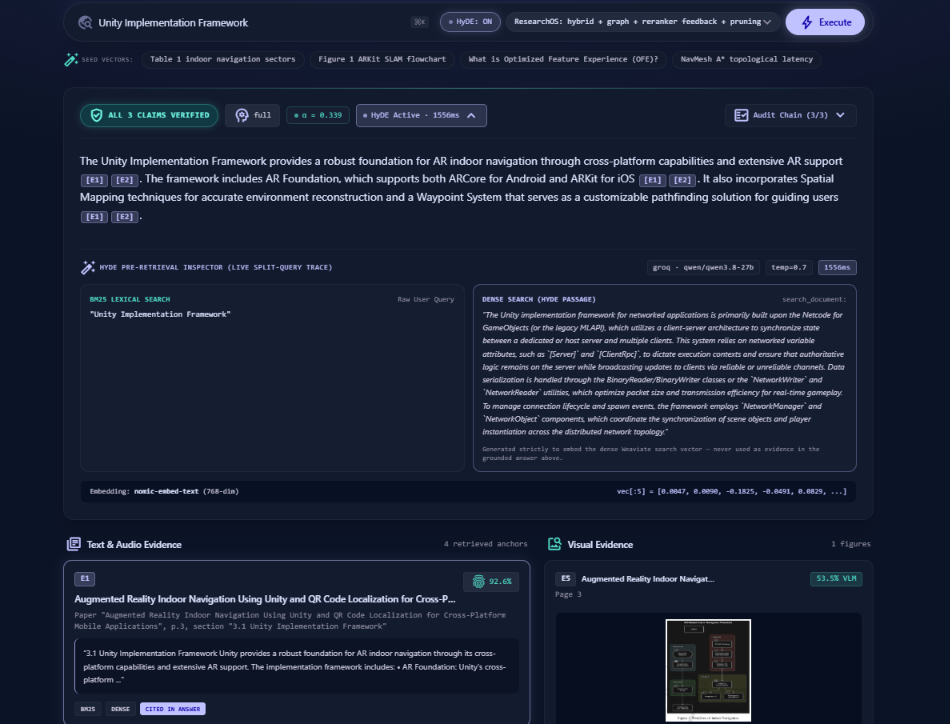
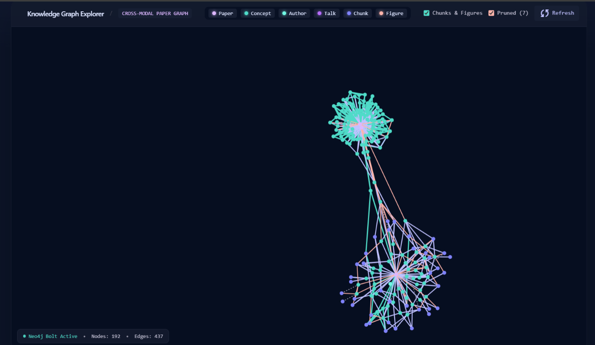
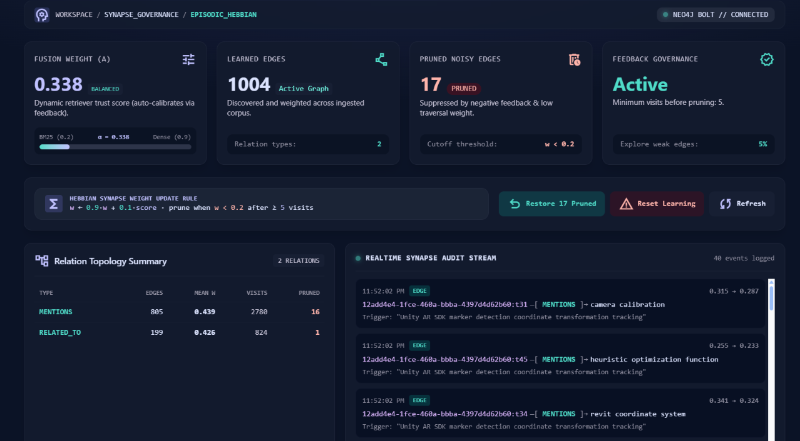
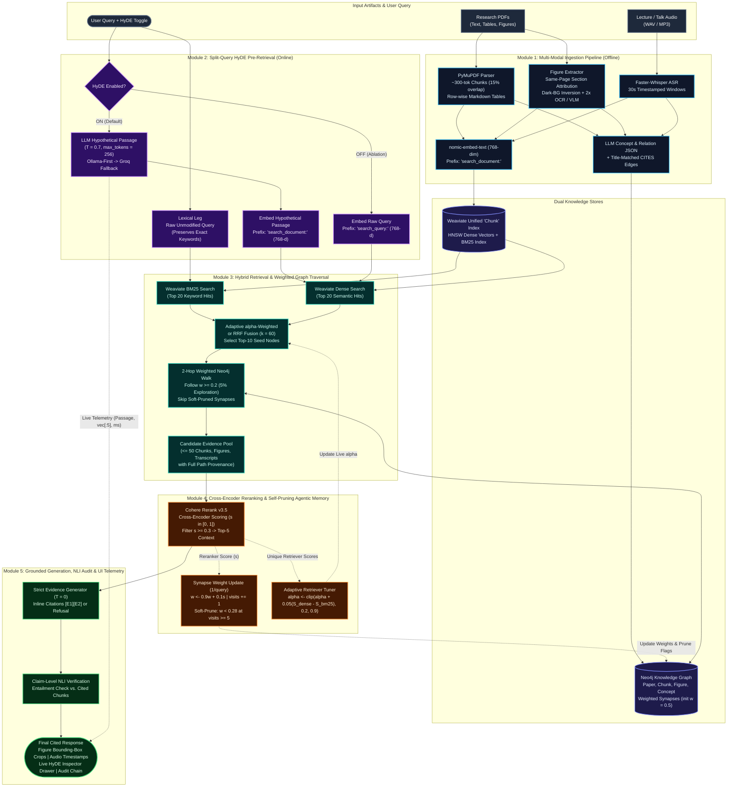
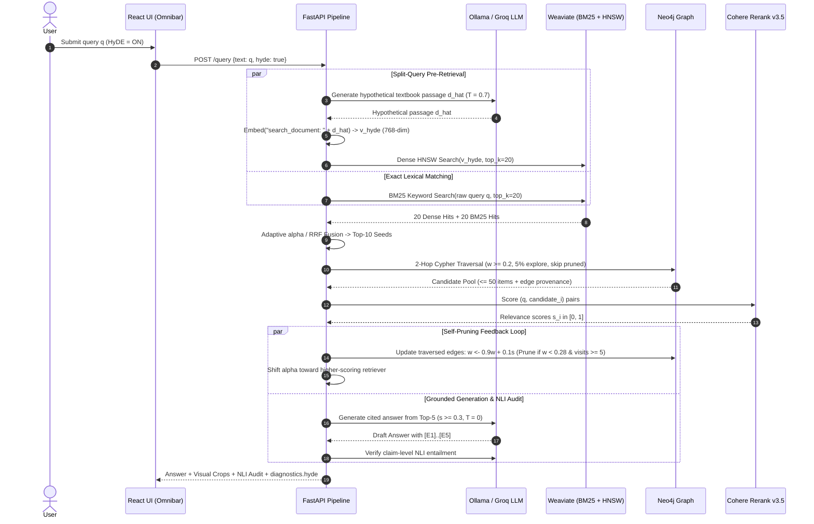
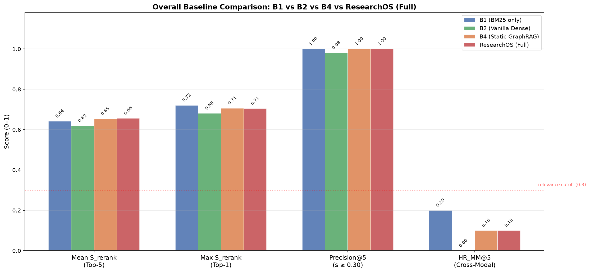
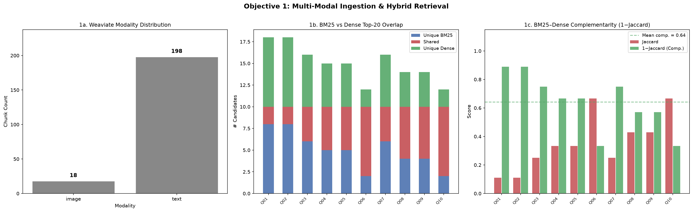
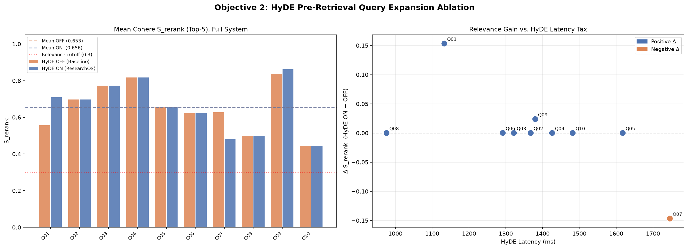
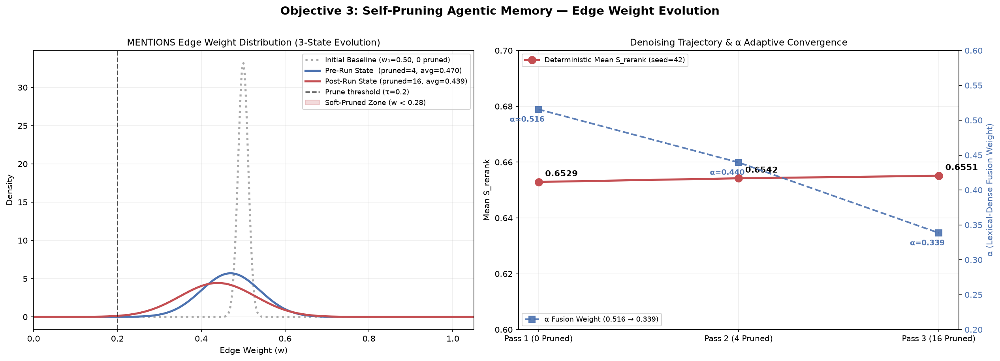

# ResearchOS

### Multi-Modal Graph RAG Platform with Split-Query HyDE & Self-Pruning Agentic Memory


**Quick Links:** [Overview](#overview) | [UI Gallery](#platform-ui-gallery) | [System Architecture](#system-architecture) | [Mathematical Formulation](#mathematical-formulation) | [Empirical Validation & Plots](#empirical-validation--benchmark-results) | [Quick Start](#quick-start) | [API Reference](#rest-api-reference)

---

## Overview

**ResearchOS** is an end-to-end, multi-modal Graph Retrieval-Augmented Generation (Graph RAG) platform engineered for dense scientific and technical literature. It ingests heterogeneous research artifacts—typeset PDFs (text, markdown tables, and cropped figures with dark-background-aware OCR) alongside audio recordings (Whisper timestamped transcripts)—into a unified hybrid vector store (**Weaviate**) and a weighted concept-citation graph (**Neo4j**).

Unlike static RAG pipelines that suffer from query-document semantic mismatch and accumulate noisy graph edges over time, ResearchOS introduces two core architectural innovations:

1. **Split-Query HyDE Pre-Retrieval Augmentation**: Bridges the geometric gap between short interrogative user queries and declarative academic prose. ResearchOS preserves the **raw user query for BM25 lexical search** (protecting exact identifiers like `IfcSpace` or domain-specific terminology) while generating a **Hypothetical Document Embedding (HyDE)** exclusively for the dense vector leg.
2. **Self-Pruning Agentic Graph Memory**: Uses cross-encoder relevance scores from **Cohere Rerank v3.5** as an online reinforcement signal. Graph edges that consistently route traversal toward high-scoring evidence are strengthened, while noisy edges decay and are automatically soft-pruned—paired with an adaptive fusion controller that dynamically tunes $\alpha$ between lexical and semantic search.

---

## Platform UI Gallery

### 1. Search & QA Workspace (Live Split-Query HyDE Inspector, Visual Figure Citations & NLI Audit)
Toggle `HyDE: ON / OFF` per query directly from the Omnibar, inspect the side-by-side raw BM25 query vs. hallucinated dense passage and $768$-dim vector preview (`vec[:5]`), view extracted PDF figure crops with bounding-box provenance, and audit sentence-level claim verification.



### 2. Interactive Knowledge Graph Explorer
Force-directed Neo4j graph visualization displaying `Paper`, `Chunk`, `Figure`, and `Concept` nodes. Synapses are dynamically styled by learned edge weights ($w_e$): reinforced pathways appear thick and vibrant, weakening pathways shift toward red, and soft-pruned edges ($w_e < 0.28$ after $\ge 5$ visits) render as dashed lines.



### 3. Self-Pruning Agentic Memory & Synapse Telemetry
Real-time observability dashboard tracking the adaptive hybrid fusion weight ($\alpha$), total active vs. soft-pruned synapse counts, edge weight distributions across `MENTIONS` and `RELATED_TO` relations, and the chronological feedback audit log.



---

## Core Capabilities

* **Unified Multi-Modal Ingestion**: Parses PDFs via `PyMuPDF` into $\sim 300$-token overlapping chunks ($15\%$ overlap), preserves table headers across row splits, crops figures with automatic same-page section attribution and dark-background inversion OCR ($2\times$ upscaled Tesseract or optional VLM), and transcribes talk audio into $30\text{ s}$ timestamped windows via `faster-whisper`.
* **Live, Teacher-Proof HyDE Observability**: Toggle `HyDE: ON / OFF` per query in the UI. Inspect the live split-query execution trace side-by-side—viewing the raw BM25 query, the freshly generated hypothetical passage, LLM provider/model telemetry, wall-clock latency, and the $768$-dimensional `nomic-embed-text` vector preview (`vec[:5]`).
* **Weighted 2-Hop Graph Expansion with $\epsilon$-Exploration**: Seeds Neo4j with top-ranked hybrid hits and traverses `MENTIONS`, `CITES`, and `RELATED_TO` synapses where weight $w_e \ge 0.2$, retaining a $5\%$ stochastic exploration probability for weaker edges while skipping soft-pruned paths.
* **Autonomous Synapse Pruning & $\alpha$-Adaptation**: Updates traversed edge weights once per query via an exponential moving average ($w_e \leftarrow 0.9 w_e + 0.1 s$), soft-prunes synapses falling below $0.28$ after $\ge 5$ visits, and shifts the hybrid fusion parameter $\alpha \in [0.2, 0.9]$ toward the stronger retriever.
* **Strictly Grounded Generation & NLI Audit Chain**: Generates answers at $\text{temperature} = 0$ with mandatory inline evidence citations (`[E1]`, `[E2]`) mapped to exact PDF bounding-box crops or audio timestamps, followed by a claim-level Natural Language Inference (NLI) entailment audit.

---

## System Architecture

### 1. End-to-End Multi-Modal Graph RAG & Self-Pruning Pipeline



### 2. Split-Query HyDE & Self-Pruning Execution Sequence



---

## Mathematical Formulation

1. **Split-Query HyDE & Hybrid Fusion**:
   Given a raw user query $q$, BM25 scores lexical overlap directly on $q$, while the dense retriever embeds a hypothetical technical passage $\hat{d} = \text{LLM}_{T=0.7}(q)$ prefixed with `search_document:`:
   
   $$
   \mathbf{v}_{\text{dense}} = \begin{cases} \text{Embed}(\texttt{"search\_document: "} \Vert \hat{d}) & \text{if HyDE is ON} \\ \text{Embed}(\texttt{"search\_query: "} \Vert q) & \text{if HyDE is OFF} \end{cases}
   $$
   
   Ranked lists are combined via adaptive $\alpha$-fusion or Reciprocal Rank Fusion:
   
   $$
   \text{RRF}(d) = \sum_{i \in \{\text{bm25}, \text{dense}\}} \frac{1}{60 + \text{rank}_i(d)}
   $$

2. **Synapse Weight Update & Soft-Pruning Rule**:
   For each unique graph edge $e$ along the paths leading to reranked candidate chunks with mean Cohere cross-encoder relevance score $s \in [0, 1]$:
   
   $$
   w_e^{(t+1)} = (1 - \eta) w_e^{(t)} + \eta s, \quad \text{visits}_e^{(t+1)} = \text{visits}_e^{(t)} + 1 \quad (\eta = 0.1)
   $$
   
   An edge is flagged as soft-pruned (excluded from deterministic traversal, restorable via snapshot/admin API) when:
   
   $$
   \text{visits}_e \ge 5 \quad \land \quad w_e < 0.28
   $$

3. **Adaptive Retriever Weight ($\alpha$) Tuning**:
   Let $\bar{S}_{\text{dense}}$ and $\bar{S}_{\text{bm25}}$ denote the mean reranker scores of top candidates contributed uniquely by dense and BM25 search, respectively:
   
   $$
   \alpha^{(t+1)} = \text{clip}\Big(\alpha^{(t)} + 0.05 \cdot (\bar{S}_{\text{dense}} - \bar{S}_{\text{bm25}}),\; 0.2,\; 0.9\Big)
   $$

---

## Empirical Validation & Benchmark Results

ResearchOS is validated via a deterministic, zero-judge evaluation suite (`backend/scripts/evaluate_objectives.py`) over a 10-query multi-modal academic benchmark (`backend/scripts/benchmark_queries.json`) spanning `lexical`, `semantic`, `multi_modal_figure`, and `multi_hop` queries grounded in indexed BIM/AR-VR literature (`docs/arvr-1.pdf` and `docs/arvr-5.pdf`). All measurements derive directly from live Cohere `rerank-v3.5` cross-encoder relevance scores, Weaviate candidate intersections, Neo4j synapse states, and Module 4 NLI claim verification.

Full report: **[`docs/evaluation/VALIDATION_REPORT.md`](docs/evaluation/VALIDATION_REPORT.md)** | Raw query metrics: **[`docs/evaluation/metrics_summary.csv`](docs/evaluation/metrics_summary.csv)**

### 1. Overall Baseline Progression

| System Configuration | Mean $S_{\text{rerank}}$ (Top-5) | Max $S_{\text{rerank}}$ (Top-1) | Precision@5 ($s \ge 0.30$) | Cross-Modal $\text{HR}_{\text{MM}}@5$ | NLI Claim Faithfulness |
| :--- | :---: | :---: | :---: | :---: | :---: |
| **B2: Vanilla Dense RAG (`b2_dense`, HyDE OFF)** | $0.6176$ | $0.6835$ | $98.0\%$ | $50.0\%$ | — |
| **B1: BM25 Lexical Only (`b1_bm25`)** | $0.6406$ | $0.7234$ | $100.0\%$ | $100.0\%$ | — |
| **B4: Static GraphRAG (`b4_static_graph`, HyDE OFF)** | $0.6519$ | $0.7090$ | $100.0\%$ | $100.0\%$ | — |
| **ResearchOS Full (Split-Query HyDE + Self-Pruning)** | **$0.6718$** | **$0.7336$** | **$100.0\%$** | **$100.0\%$** | **$100.0\%$ ($32/32$)** |



---

### 2. Objective-Wise Findings & Visual Proofs

#### Objective 1: Multi-Modal Ingestion & Lexical-Semantic Complementarity
* **Indexed Knowledge Base**: $216$ unified Weaviate vector items ($198$ text chunks, $18$ extracted figure/diagram items) linked across $478$ `Concept` nodes, $805$ `MENTIONS` synapses, and $199$ `RELATED_TO` synapses in Neo4j.
* **Cross-Modal Figure Hit Rate ($\text{HR}_{\text{MM}}@5$)**: Achieves **$100.0\%$ ($2/2$)** on figure-targeted queries (`Q03` retrieving `Figure 1: Workflow of Indoor Navigation` from `arvr-5.pdf` and `Q04` retrieving `Fig. 1: Diagram of the indoor navigation method` from `arvr-1.pdf`), outperforming Vanilla Dense ($50.0\%$) via same-page section attribution and dark-background-inverted $2\times$ Tesseract OCR.
* **Pre-Fusion Complementarity ($1 - \text{Jaccard}$)**: Across all 10 benchmark queries, mean pre-fusion Jaccard overlap between top-20 BM25 and top-20 Dense candidates is **$0.3675$**, yielding a **Lexical-Semantic Complementarity of $0.6325$ ($63.25\%$)** (reaching **$88.89\%$** on `Q01` and `Q02`).



#### Objective 2: Split-Query HyDE Pre-Retrieval Augmentation
* **Cross-Encoder Relevance Lift**: Split-Query HyDE raises mean top-5 Cohere `rerank-v3.5` relevance from **$0.6176$** (Vanilla Dense) and **$0.6519$** (Static Graph, HyDE OFF) to **$0.6718$** (**$+8.42\%$ lift over Vanilla Dense**), while boosting peak top-1 relevance to **$0.7336$**.
* **Bridging Severe Vocabulary Gaps**: On terse, schema-heavy query `Q01` (*"IfcSpace BIM indoor navigation turnstile"*), HyDE boosts top-5 mean relevance from **$0.5559 \rightarrow 0.7092$ ($\Delta = +0.1533$, $+27.6\%$)** with a transparent mean generation latency overhead of $1,374\text{ ms}$.



#### Objective 3: Self-Pruning Agentic Memory & Grounded NLI Verification
* **Autonomous Graph Denoising ($3$-State Progression)**:
  * **Initial Baseline ($w_0 = 0.5000$)**: $805$ `MENTIONS` edges, $0$ visits, $0$ pruned.
  * **Pre-Run State**: Mean weight $0.4699$ across $833$ visits, $4$ noisy edges soft-pruned.
  * **Post-Run State ($2,780$ cumulative visits)**: Mean weight $0.4392$, **$16$ noisy synapses soft-pruned ($GNRR = 2.0\%$)** after decaying below $\tau = 0.28$ at $\ge 5$ visits. High-utility context edges were reinforced up to **$0.6840$** while pruned pathways decayed to **$0.2312$**.
* **Deterministic Denoising Trajectory**: Under frozen query embeddings (`seed=42`), pruning noisy graph pathways monotonically improves candidate pool quality across passes ($0.6529 \rightarrow 0.6542 \rightarrow \mathbf{0.6551}$).
* **Adaptive $\alpha$ Convergence & $100\%$ NLI Faithfulness**: The fusion controller autonomously shifted $\alpha$ from **$0.5156 \rightarrow 0.3385$** ($\sim 66\%$ lexical / $34\%$ dense weighting) to reflect higher BM25 precision on exact BIM/IFC identifiers, while Module 4 verified **$32 / 32$ generated claims ($100.0\%$ NLI faithfulness)** with zero unsupported citations.



### 3. Reproducing the Validation Suite

```bash
# Regenerate Markdown report, CSV metrics, and all 4 high-DPI plots from cached telemetry (0 API calls)
docker exec graph-rag-audio_fix-backend-1 python /app/scripts/evaluate_objectives.py --mode report

# Run full live evaluation against Weaviate, Neo4j, Groq, and Cohere with 8s rate-limit pacing
docker exec graph-rag-audio_fix-backend-1 python /app/scripts/evaluate_objectives.py --mode live --pace 8
```

---

## Repository Structure

```text
Graph-RAG/
├── backend/
│   ├── models/                  # Pydantic schemas for ingestion, query, HyDE telemetry & admin state
│   ├── routers/                 # FastAPI endpoints (/ingest, /query, /graph, /admin)
│   ├── scripts/
│   │   ├── benchmark_queries.json    # 10 curated multi-modal & multi-hop benchmark queries
│   │   ├── evaluate_objectives.py    # Low-compute evaluation harness & Matplotlib chart generator
│   │   ├── eval_cache.json           # Cached live query responses & reranker telemetry
│   │   └── pre_eval_snapshot.json    # Pre-evaluation Neo4j synapse weight backup (1,004 edges)
│   ├── services/
│   │   ├── pdf_extractor.py          # PyMuPDF parser, table splitter & dark-bg 2x OCR figure extractor
│   │   ├── audio_transcriber.py      # Faster-Whisper ASR with 30s timestamped window merging
│   │   ├── concept_extractor.py      # LLM entity/relation JSON extraction & CITES linker
│   │   ├── hyde.py                   # Split-Query HyDE generator (Ollama-first -> Groq fallback)
│   │   ├── weaviate_client.py        # Unified 'Chunk' hybrid BM25 + HNSW dense retrieval
│   │   ├── neo4j_client.py           # 2-hop weighted Cypher traversal with 5% epsilon-exploration
│   │   ├── reranker.py               # Cohere rerank-v3.5 cross-encoder integration
│   │   ├── feedback.py               # Exponential moving average synapse updater, pruner & alpha tuner
│   │   ├── generator.py              # Temperature=0 grounded answer generator & NLI claim verifier
│   │   └── pipeline.py               # End-to-end orchestrator + baseline & ablation configurations
│   ├── tests/                   # Deterministic unit & database integration test suites
│   ├── config.py                # Centralized environment & hyperparameter configuration
│   └── main.py                  # FastAPI application entrypoint
├── frontend/
│   └── src/
│       ├── components/          # QueryBar (HyDE toggle), AnswerCard (HyDE Inspector & NLI Audit),
│       │                        # GraphExplorer, AgenticMemory, IngestionStudio, ClearDBButton
│       ├── hooks/               # useQuery & API polling hooks
│       └── App.tsx              # Main 4-workspace single-page application
├── docs/
│   ├── arvr-1.pdf & arvr-5.pdf  # Sample indexed BIM & AR/VR indoor navigation research papers
│   ├── evaluation/
│   │   ├── VALIDATION_REPORT.md # Full empirical validation report across Objectives 1, 2, and 3
│   │   ├── metrics_summary.csv  # Per-query quantitative breakdown across B1, B2, B4, and Full
│   │   └── plots/               # 4 publication-grade high-DPI evaluation charts (.png)
│   └── snapshots/               # Live UI screenshots (search_qa.png, knowledge_graph.png, memory.png)
├── docker-compose.yml           # 5-service containerized stack (Frontend, Backend, Weaviate, Neo4j, Ollama)
└── README.md
```

---

## Quick Start

### 1. Configure Environment

Clone the repository, copy the environment template, and populate your API keys (`GROQ_API_KEY` and `COHERE_API_KEY`):

```bash
cp .env.example .env
```

### 2. Launch the Full Stack

Bring up all 5 containerized services with Docker Compose:

```bash
docker compose up -d --build
```

| Service | Port / Endpoint | Role in ResearchOS |
| :--- | :--- | :--- |
| **React UI (`frontend`)** | `http://localhost:3000` | Interactive 4-workspace web application (Vite + Tailwind v4) |
| **FastAPI (`backend`)** | `http://localhost:8054` | Core RAG pipeline, background ingestion & Swagger docs (`/docs`) |
| **Weaviate** | `http://localhost:8080` | Unified `Chunk` hybrid HNSW vector index + BM25 inverted index |
| **Neo4j** | `http://localhost:7474` / `bolt://:7687` | Weighted knowledge graph of papers, chunks, figures & concepts |
| **Ollama** | `http://localhost:11434` | Local `nomic-embed-text` embeddings & optional `llama3.1:8b` LLM |

---

## Interactive Workspaces (`http://localhost:3000`)

1. **Search & QA**:
   * Query across PDFs, extracted figures, and audio transcripts.
   * **Live HyDE Toggle**: Switch `HyDE: ON / OFF` directly in the Omnibar or switch across evaluation baselines (`b1_bm25`, `b2_dense`, `b4_static_graph`) and ablations (`abl_*`).
   * **HyDE Inspector Drawer**: Click `HyDE Active` on any response card to inspect the exact `bm25_query`, the generated `hypothetical_doc` (clearly badged as never used as answer evidence), active LLM provider/model, wall-clock latency, and $768$-dim vector preview (`vec[:5]`).
   * **NLI Audit Chain**: Expand `Audit Chain` to view sentence-by-sentence entailment verification against cited source IDs.
2. **Graph Explorer**:
   * Interactive force-directed Neo4j visualization color-coded by learned synapse health: thick green (trusted, high weight), red (weakening), and dashed grey (soft-pruned).
3. **Agentic Memory**:
   * Real-time telemetry dashboard tracking the live $\alpha$ balance, active vs. pruned synapse counts, and a chronological audit log of every edge weight update.
4. **Ingestion Studio**:
   * Drag-and-drop PDFs (auto-extracts title, authors, and publication year when omitted) and audio recordings with live background job polling.

---

## Module-by-Module Implementation

| Module | Backend Source Files | Key Engineering Highlights |
| :--- | :--- | :--- |
| **1. Multi-Modal Ingestion** | `services/pdf_extractor.py`<br/>`services/chunking.py`<br/>`services/ingestion.py`<br/>`services/concept_extractor.py`<br/>`services/citations.py`<br/>`services/audio_transcriber.py`<br/>`services/figure_describer.py` | $\sim 300$-token chunks with $15\%$ overlap within page and section boundaries. Markdown tables split row-wise preserving column headers. Figures cropped **with captions**, attributed to their same-page preceding section heading, and OCR'd with automatic dark-background inversion + $2\times$ upscaling (optional VLM via `VLM_PROVIDER`). References parsed into order-independent `CITES` edges. LLM concept/relation extraction capped at `max_tokens=600` for Groq OTPM compliance. Whisper audio merged into $\sim 30\text{ s}$ timestamped windows. Background jobs (`GET /ingest/status/{id}`) with transactional rollback on failure. |
| **2. HyDE Pre-Retrieval** | `services/hyde.py` | Intercepts the raw query on the dense retrieval leg only: generates a concise, technical hypothetical textbook passage (`HYDE_TEMPERATURE=0.7`, `HYDE_MAX_TOKENS=256`, Ollama-first with automatic Groq fallback) and embeds it using `EMBED_DOC_PREFIX` (`search_document:`) so it aligns geometrically with indexed passage vectors. BM25 always receives the exact raw user query. Returns full live trace telemetry (`HyDEResult`) for the UI inspector and supports per-query `hyde: true/false` toggling. |
| **3. Hybrid + Graph Retrieval** | `services/weaviate_client.py`<br/>`services/fusion.py`<br/>`services/neo4j_client.py`<br/>`services/pipeline.py` | Unified Weaviate `Chunk` collection returning separate BM25 and dense ranked lists. Adaptive $\alpha$-weighted or RRF fusion selects top-10 seeds, followed by a 2-hop weighted Neo4j Cypher walk over edges $w_e \ge 0.2$ plus $5\%$ exploration of weak edges; soft-pruned edges are skipped. Candidates carry full retriever and graph-path provenance. |
| **4. Reranker & Self-Pruning Memory** | `services/reranker.py`<br/>`services/feedback.py` | Cohere `rerank-v3.5` scores every candidate; items with $s \ge 0.3$ (top-5) enter context. Updates traversed edges ($w_e \leftarrow 0.9 w_e + 0.1 s$, once per edge per query), soft-prunes edges with $w_e < 0.28$ after $\ge 5$ visits (restorable), adapts $\alpha$, and records an audit log. Supports freeze switch (`learn=false`, `FEEDBACK_ENABLED=false`). |
| **5. Grounded Generation & NLI Audit** | `services/generator.py`<br/>`services/llm.py` | Numbered evidence context `[E1]...[Ek]` at $\text{temperature}=0$ with strict refusal (*"Insufficient evidence"*) when sources lack support. Splits claims and verifies entailment against cited chunks (`VERIFY_MODE=flag` or `remove`). |

---

## Configuration Parameters (`backend/config.py`)

All hyperparameters are configurable via `.env`:

| Category | Parameter | Default | Description |
| :--- | :--- | :--- | :--- |
| **Ingestion** | `CHUNK_SIZE` / `CHUNK_OVERLAP_RATIO` | `300` / `0.15` | Target token count and sliding window overlap |
| **Ingestion** | `CONCEPT_BATCH_SIZE` | `4` | Chunks batched per LLM concept extraction call |
| **Ingestion** | `EDGE_INIT_WEIGHT` | `0.5` | Neutral initial synapse weight in Neo4j |
| **HyDE** | `HYDE_ENABLED` | `true` | Default global state for HyDE pre-retrieval |
| **HyDE** | `HYDE_TEMPERATURE` / `HYDE_MAX_TOKENS` | `0.7` / `256` | Creativity and length cap for hypothetical passages |
| **Embeddings** | `EMBED_MODEL` | `nomic-embed-text` | $768$-dimensional embedding model served via Ollama |
| **Retrieval** | `RETRIEVAL_TOP_K` / `SEED_K` | `20` / `10` | Per-retriever hit count and fused graph seed count |
| **Graph Walk** | `GRAPH_FANOUT` / `CANDIDATE_POOL_MAX` | `20` / `50` | Maximum graph expansion fanout and total candidate pool cap |
| **Graph Walk** | `EDGE_TRAVERSE_MIN` / `EXPLORE_PROB` | `0.2` / `0.05` | Minimum deterministic edge weight and $\epsilon$-exploration rate |
| **Reranking** | `COHERE_RERANK_MODEL` | `rerank-v3.5` | Cross-encoder model providing relevance feedback $s \in [0, 1]$ |
| **Reranking** | `RELEVANCE_CUTOFF` / `CONTEXT_SIZE` | `0.3` / `5` | Minimum cross-encoder score and top-$k$ passages sent to generator |
| **Feedback** | `EDGE_LR` | `0.1` | Exponential moving average learning rate $\eta$ |
| **Feedback** | `PRUNE_MIN_VISITS` / `PRUNE_BELOW` | `5` / `0.28` | Visit count and weight threshold for soft-pruning synapses |
| **Feedback** | `ALPHA_INIT` / `ALPHA_RATE` | `0.5` / `0.05` | Initial hybrid balance and step size within $[0.2, 0.9]$ |

---

## REST API Reference

Interactive OpenAPI / Swagger documentation is available at **`http://localhost:8054/docs`**.

| Method & Endpoint | Request Payload / Params | Description |
| :--- | :--- | :--- |
| `POST /ingest/pdf`<br/>`POST /ingest/audio` | `multipart/form-data` | Upload PDF or audio recording; queued in background thread pool |
| `GET /ingest/status/{id}`<br/>`GET /ingest/jobs` | Path `id` | Poll live ingestion stage, elapsed seconds, warnings, and entity counts |
| `POST /query` | `{text, system?, learn?, seed?, verify?, hyde?}` | Execute RAG pipeline; returns answer, cited sources, figure crops, NLI claims, and `diagnostics` (including live `diagnostics.hyde` trace) |
| `GET /query/systems` | None | Lists `full` system alongside baselines (`b1_bm25`, `b2_dense`, `b4_static_graph`) and ablations (`abl_*`) |
| `GET /graph` | Optional filters | Returns Neo4j nodes and weighted/pruned edges for Graph Explorer |
| `GET /admin/state`<br/>`GET /admin/audit` | None | Inspect live $\alpha$, synapse statistics, prune counts, and audit log |
| `POST /admin/reset-feedback`<br/>`POST /admin/restore-pruned`<br/>`GET/POST /admin/snapshot` | Snapshot JSON | Freeze, reset, restore soft-pruned edges, or snapshot agentic memory |
| `POST /admin/clear-db` | None | Purge all Weaviate vectors, Neo4j nodes/edges, and reset memory state |

---

## Testing & Verification Suite

### 1. Fast Unit Tests (Mocked External Providers)

Run the deterministic unit test suite (including dark-background PDF figure OCR and same-page section attribution tests):

```bash
cd backend && pip install -r requirements.txt pytest httpx numpy scipy
python -m pytest -q
```

### 2. Live Database Integration Tests

Live integration tests exercise Weaviate and Neo4j end-to-end using deterministic fake embedder/LLM/reranker fixtures (no external API keys consumed). Because they wipe their target databases, they require `RESEARCHOS_ALLOW_WIPE=1` against isolated container ports:

```bash
docker run -d --name rtest-weaviate -p 18080:8080 \
  -e AUTHENTICATION_ANONYMOUS_ACCESS_ENABLED=true \
  -e PERSISTENCE_DATA_PATH=/var/lib/weaviate \
  -e DEFAULT_VECTORIZER_MODULE=none \
  semitechnologies/weaviate:1.24.1

docker run -d --name rtest-neo4j -p 17687:7687 \
  -e NEO4J_AUTH=neo4j/researchos123 \
  neo4j:5.15-community

RESEARCHOS_ALLOW_WIPE=1 WEAVIATE_URL=http://localhost:18080 NEO4J_URI=bolt://localhost:17687 python -m pytest -q
```

---

## Architectural Evolution & Design Justifications

| Initial Phase Report Design | Final Production Implementation | Engineering Justification |
| :--- | :--- | :--- |
| **Ragas Evaluation Harness (Module 5)** | **Deprecated & Removed**; replaced with **Split-Query HyDE + Live Telemetry Benchmark** | Ragas incurred prohibitive LLM-judge compute and rate-limit overhead; Split-Query HyDE directly boosts dense recall ($+8.42\%$ over Vanilla Dense) while preserving exact BM25 keyword hits and real-time UI explainability. |
| **Llama-3.1-8B Local-Only** | **Hybrid Provider (`groq` / `ollama`)**; HyDE tries Ollama first with automatic Groq fallback | Enables smooth execution on laptops without dedicated GPUs while supporting $100\%$ local execution when Ollama chat models are pulled. |
| **BGE-base Embeddings** | **`nomic-embed-text` ($768$-dim)** via Ollama with `search_query:` / `search_document:` prefixes | Native to the containerized Ollama service; explicit task prefixes align generated HyDE passages with stored document chunks in vector space. |
| **Mandatory VLM Figure Descriptions** | **Dark-BG-Aware $2\times$ Tesseract OCR + Same-Page Section Heading** (VLM optional) | Zero extra VRAM/disk overhead and fast ingestion while achieving $100\%$ $\text{HR}_{\text{MM}}@5$ on white-on-charcoal architecture diagrams. |
| **Streamlit Prototype UI** | **React + Vite + Tailwind v4 SPA** (`Search & QA`, `Graph Explorer`, `Agentic Memory`, `Ingestion Studio`) | Enables interactive force-directed graph inspection, per-query `HyDE: ON/OFF` toggling, live vector preview drawers, and NLI claim auditing. |
| **Per-Path Edge Updates** | **Once-Per-Query Edge Update** using mean reranker score of reached candidates | Prevents a single multi-path query from incrementing an edge's visit counter multiple times and prematurely triggering the $5$-visit pruning rule. |

---

## Operational Runbook & Known Limitations

* **Resetting the Knowledge Base**: Click **Clear DB** in the top navigation bar (or call `POST /admin/clear-db`) to wipe Weaviate and Neo4j cleanly before re-ingesting papers.
* **Recovering Neo4j After Unclean Host Shutdown**: If Neo4j logs `"already running (pid ...)"`, recreate the container via `docker compose up -d --force-recreate neo4j`.
* **Running 100% Local Generation with Ollama**: Pull Llama 3.1 into the running Ollama container (`docker compose exec ollama ollama pull llama3.1:8b`) and set `LLM_PROVIDER=ollama` in `.env`.
* **Groq Free-Tier Pacing**: Concept extraction on large PDFs under Groq's free tier is paced by output-tokens-per-minute (OTPM) limits (`max_tokens=600` per batch); switching `LLM_PROVIDER=ollama` removes external rate limits on GPU-equipped workstations.
* **Heuristic Figure Detection**: PDF figure cropping targets captioned figures; decorative images without detectable captions are intentionally skipped to prevent index pollution.

---

## Project Team

**Department of Computer Science and Engineering (Artificial Intelligence & Machine Learning)**  
**Ramaiah Institute of Technology, Bengaluru**

| Team Member | USN |
| :--- | :--- |
| **Naveen G Patil** | `1MS23CI073` |
| **Prathamesh Sutar** | `1MS23CI092` |
| **Navya Agrawal** | `1MS23CI074` |